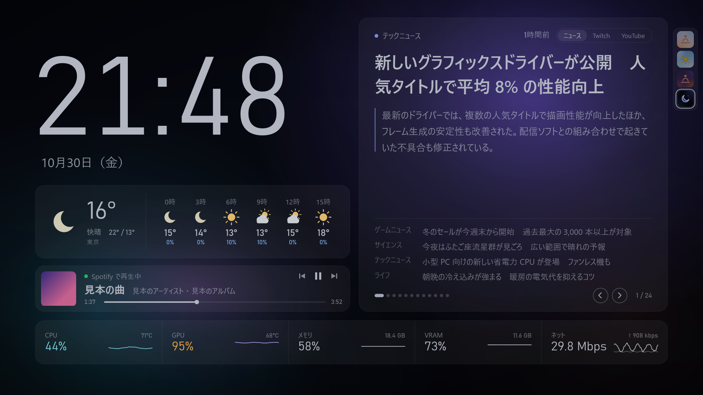
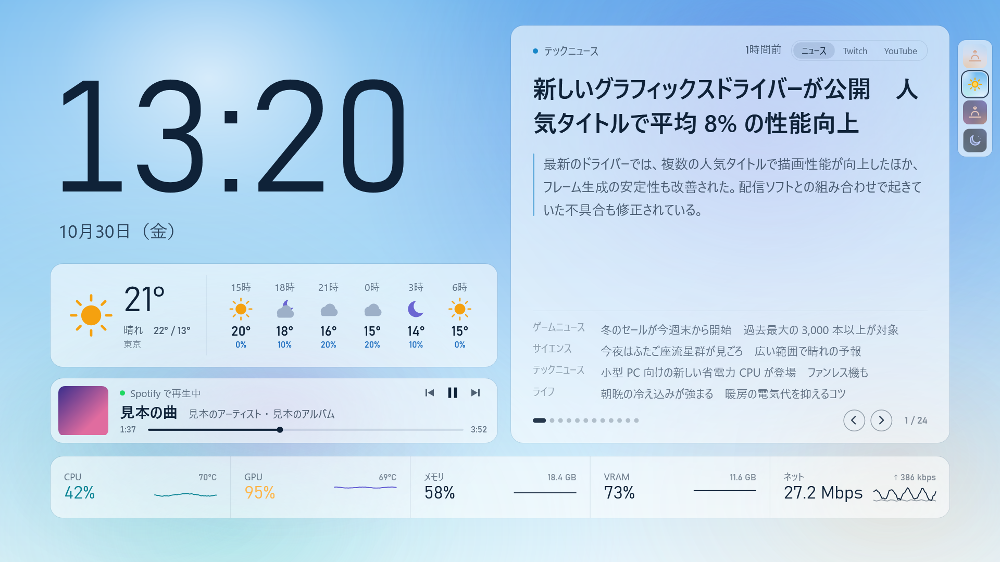
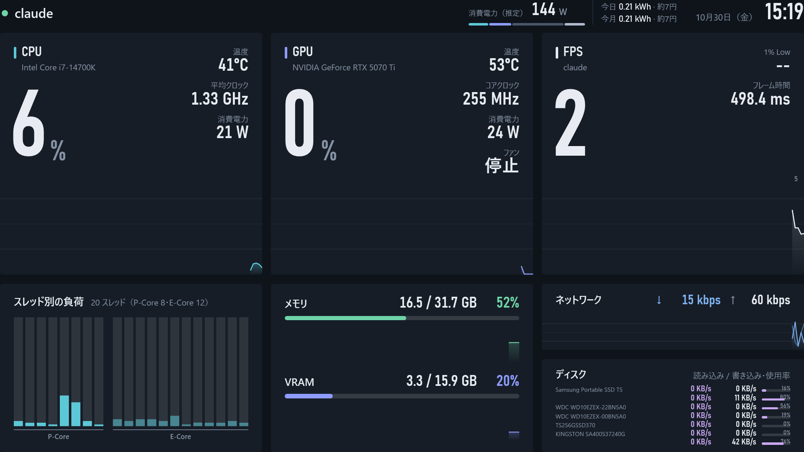
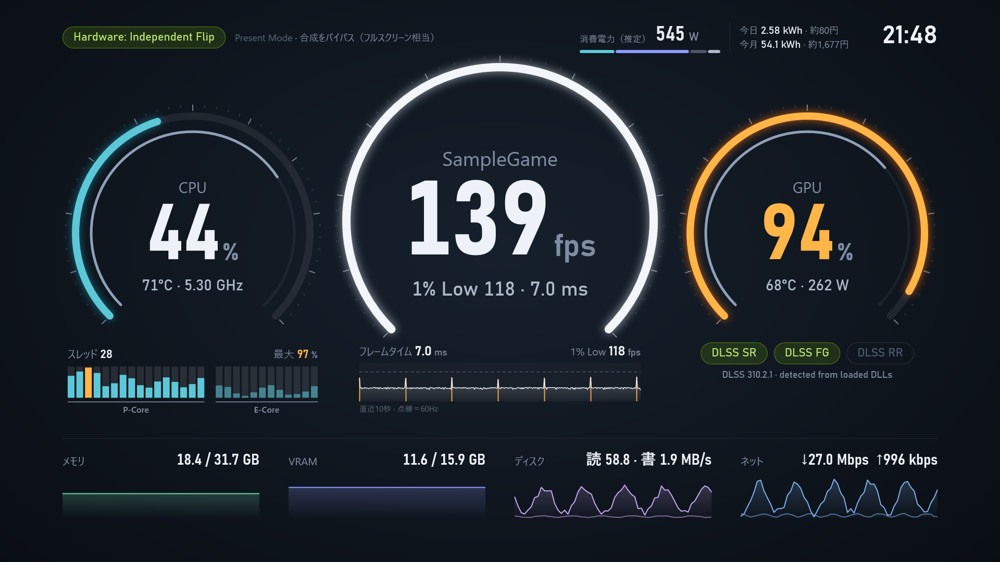

# MyDashboard

サブモニターに全画面で表示しておく「動く壁紙」兼 PC モニターです。
ゲーム中は CPU・GPU・FPS・メモリ・VRAM などの負荷を、普段は時計・天気・ニュース・Twitch・YouTube を表示します。
1920×1080 を基準に作ってあり、どの解像度のモニターでも縦横比を保って拡大縮小されます。

**オーロラ**：普段使い向け。時計・天気・再生中の曲・ニュース／Twitch／YouTube が主役の壁紙寄り。色は時間帯で変わる（左＝夜、右＝昼）

| | |
| --- | --- |
|  |  |

| **標準**：ゲーム中向け。情報量重視 | **計器盤**：ゲーム中向け。FPS が見やすい円弧メーター |
| --- | --- |
|  |  |

※ 画像は見本のデータで作ったものです（ゲーム名・ニュース・曲名は架空）。

> 開発者向けの情報（ソースの構成・ビルド方法・注意点）は `PROJECT.md` にあります。

## 目次

1. [はじめかた](#はじめかた)
2. [操作](#操作)
3. [レイアウト](#レイアウト)
4. [ニュースと天気](#ニュースと天気)
5. [再生中の曲（オーロラ）](#再生中の曲オーロラ)
6. [Twitch（オーロラ）](#twitchオーロラ)
7. [YouTube（オーロラ）](#youtubeオーロラ)
8. [消費電力（標準・計器盤）](#消費電力標準計器盤)
9. [FPS の計測](#fps-の計測)
10. [設定](#設定)
11. [困ったとき](#困ったとき)

---

## はじめかた

### 動く環境

- Windows 10（2004 以降）/ Windows 11、64 ビット
- .NET などの追加インストールは不要です（exe に入っています）

### ダウンロード

[最新版の MyDashboard.exe](https://github.com/Kinefuchi1942/MyDashboard/releases/latest/download/MyDashboard.exe) をダウンロードします（過去の版は [Releases](https://github.com/Kinefuchi1942/MyDashboard/releases)）。
配るのはこの exe 1つだけです。設定ファイルなどは初めて起動したときに exe と同じフォルダに作られます。

### 起動する

1. `MyDashboard.exe` を専用のフォルダに置きます（例：`D:\MyDashboard\MyDashboard.exe`）。`C:\Program Files` の下には置かないでください（設定を保存できません）
2. `MyDashboard.exe` をダブルクリックします
   - 「Windows によって PC が保護されました」と出たら「詳細情報」→「実行」（個人が作ったアプリのため出ます）
   - 「このアプリがデバイスに変更を加えることを許可しますか？」は「はい」（CPU 温度と FPS を読むために管理者権限で動きます）
3. メイン以外のモニターに全画面で表示されます。別のモニターに出たときは `M` キーで移動します（選んだモニターは記憶されます）

### CPU 温度を表示するには（PawnIO）

CPU の温度・クロック・電力を読むには **PawnIO** ドライバが必要です。
画面上部に「CPU温度を出すには PawnIO が必要です」と出ていたら、<https://pawnio.eu/> からインストールして、ダッシュボードを起動し直してください。
（GPU・メモリ・ディスク・ネットワーク・FPS は PawnIO がなくても表示されます）

### Windows の起動時に自動で開く

1. ダッシュボードを右クリック →「サインイン時に自動起動」にチェックを入れます
2. 次のサインインから、約20秒後に UAC の確認なしで起動します（タスクスケジューラに「MyDashboard」として登録されます）

- やめるときは、同じ項目のチェックを外します
- exe を別の場所に移したら、移した先の exe で一度チェックを外してから入れ直してください

### 終了・アンインストール

- 終了：`Ctrl + Q`、または右クリックメニューの「終了」
- アンインストール：自動起動を登録していたら右クリックメニューでチェックを外してから、フォルダごと削除します。ほかの場所には何も書き込みません（exe の隣に書き込めないときだけ、FPS 計測用の `PresentMon.exe` を `%LOCALAPPDATA%\MyDashboard` に置きます）

---

## 操作

画面を右クリックするとメニューが出ます。キー操作は、ダッシュボードを一度クリックしてから使えます。

| 操作 | キー |
| --- | --- |
| 設定画面を開く | `S` |
| 次のレイアウトへ切り替え | `L` |
| 次のモニターへ移動（選んだモニターは記憶されます） | `M` |
| 常に背後に表示の切り替え | `B` |
| 終了 | `Ctrl + Q` |

右クリックメニューには、ほかに「サインイン時に自動起動」（[自動起動](#windows-の起動時に自動で開く)）と「設定ファイルを開く」があります。

- **常に背後に表示**：オンにすると、ダッシュボードをクリックしてもブラウザなどの後ろのままになります（壁紙のような使い方）。この間はキーが届かないので、切り替えは右クリックメニューか設定画面で行います
- ダッシュボードは起動時にフォーカスを奪わないので、ゲーム中に起動しても大丈夫です
- フルスクリーン（排他モード）のゲーム中にダッシュボードをクリックすると、ゲームが最小化されることがあります。ゲームを「ボーダーレス ウィンドウ」にしておくと安心です

---

## レイアウト

3種類の見た目を切り替えられます。右クリック →「レイアウト」から選ぶか、`L` キーで順番に切り替わります。選んだレイアウトは次回も使われます。

| レイアウト | 向いている使い方 |
| --- | --- |
| 標準 | ゲーム中。情報量重視で、スレッドごとの負荷やディスクごとの速度まで一覧できる |
| 計器盤 | ゲーム中。車の計器のような円弧メーターで、FPS とフレームタイムが見やすい |
| オーロラ | 普段使い。大きな時計・天気・ニュース／Twitch／YouTube が主役の壁紙寄り |

数字はふだんは白で、しきい値を超えると琥珀色（注意）、さらに超えると赤（危険）になります。しきい値は設定画面の「警告の目安」で変えられます。

### 標準

| 場所 | 内容 |
| --- | --- |
| 上段左 | CPU 使用率（大きな数字）、温度、平均クロック、消費電力。背景の面グラフは直近90秒の推移 |
| 上段中 | GPU 使用率、温度、コアクロック、消費電力、ファン回転数 |
| 上段右 | FPS、1% Low、フレーム時間。計測中のゲーム名は画面左上にも出ます |
| 下段左 | スレッドごとの負荷（棒グラフ）。P コア／E コアがある CPU では左右に分け、E コアは淡い色 |
| 下段中 | メモリと VRAM の使用量・使用率・推移 |
| 下段右 | ネットワークの受信／送信速度、ディスクごとの読み込み／書き込み速度と使用率 |

時計の左に[消費電力](#消費電力標準計器盤)が出ます。

### 計器盤

- 中央が FPS（メインモニターのリフレッシュレートが満点）、左右が CPU と GPU のメーター。外側の弧が使用率、内側の細い弧が温度
- CPU の下：スレッドごとの負荷（P-Core／E-Core 別の棒と、いちばん高いスレッドの %）
- FPS の下：直近10秒のフレームタイムのグラフと 1% Low
- 左上：Present Mode（緑＝合成なし、琥珀＝DWM 合成あり）
- 右下：DLSS の検出（SR／FG／RR）。ゲームが読み込んでいるファイルからの推定で、プリセットやフレーム生成の倍率までは分かりません
- 最下段：メモリ・VRAM・ディスク・ネット
- 時計の左に[消費電力](#消費電力標準計器盤)。ニュースは出ません

### オーロラ

- 左側：大きな時計・日付・天気（今の天気と3時間ごとの予報）。曲の再生中は天気の下に[再生中カード](#再生中の曲オーロラ)
- 右側：**メディアカード**。右上の「ニュース｜Twitch｜YouTube」で切り替えます（起動したときはニュース）
- 下段：PC の状態を控えめに表示（CPU・GPU・メモリ・VRAM・ネット）。FPS は出ません（ゲーム中は標準・計器盤で見てください）
- 背景の光が負荷に合わせて変わります（CPU＝左下の青緑、GPU＝右上の紫、高温になると右下が赤く）

**色テーマ（時間帯で変わる）**

| 時間帯 | 色 |
| --- | --- |
| 朝（日の出〜10時） | 明るい空色 |
| 昼（10時〜日の入りの1時間前） | 明るい空色 |
| 夕方（日の入りの前後1時間） | 紫と橙 |
| 夜 | ほぼ黒で少し暗め |

- 日の出・日の入りは天気と一緒に取得し、境目の30分でゆっくり移り変わります
- 画面の右端に並ぶ4つの四角いアイコンを押すと、そのテーマに固定されます。固定中のアイコンをもう一度押すと自動に戻ります（自動のときはアイコンの上に「自動」と出ます）
- 昼がまぶしいときは、設定画面「オーロラ」の「朝・昼の明るさ」を下げます
- 背景の光の動きを止めたいときは「背景のアニメーション」をオフにします（負荷に合わせた色の変化は残ります）

---

## ニュースと天気

- **ニュース**：登録した配信元（RSS）から10分ごとに見出しを取り込み、8秒ごとに切り替えて表示します（オーロラのメディアカード）
  - 見出しの下に記事の要約（最大5行）と次の記事4件が並び、右下の矢印で前後に送れます
  - 1つのサイトに偏らないよう、配信元を交互に並べます
  - 見出しを**ダブルクリック**すると、その記事をブラウザで開きます
- **天気**：[Open-Meteo](https://open-meteo.com/)（無料・登録不要）から15分ごとに取得します

### 配信元を変える

1. 設定画面（`S`）→「ニュース」
2. 「＋ 配信元を追加」で名前と RSS の URL を入れる（いらないものは削除）
3. 「保存」

RSS 2.0・RSS 1.0（RDF）・Atom のどれでも読めます。サイトの RSS の URL は、多くの場合ページ下部の「RSS」リンクにあります。

### 天気の地点を変える

1. 設定画面（`S`）→「天気」
2. 「地点を検索」に地名を入れて、候補から選ぶ（緯度・経度は自動で入ります）
3. 必要なら「表示名」を直して「保存」

---

## 再生中の曲（オーロラ）

Spotify で曲を流していると、天気カードの下に「再生中」カードが出ます。

- ジャケット・曲名・アーティスト・再生位置と、前の曲／再生・一時停止／次の曲のボタン
- カードの後ろの光はジャケットの色になります。カードが出ている間は、時計・日付・天気が少し上に寄ります
- 何も再生していないとき、または一時停止が5分続いたときはカードが消えます
- Spotify へのログインや登録は不要です（Windows の「再生中のメディア」の情報を読んでいます）
- ブラウザの YouTube なども表示したいときは、設定画面「再生中の音楽」の「Spotify だけを表示」をオフにします

---

## Twitch（オーロラ）

メディアカード右上の「Twitch」で、フォロー中の配信に切り替えます。

- **通常表示**：映像と、フォロー中で配信中のチャンネルが並びます（入りきらないときは矢印かマウスホイールで横に送ります）。押すとそのチャンネルに切り替わり、最後に見ていたチャンネルは次回も優先されます
- **拡張表示**：右上の「拡張」で、時計・天気の場所まで広げ、映像の右にチャットを出します（時計と気温は右上に小さく出ます）。「通常表示」で戻ります
- 映像は消音で始まります。音はプレーヤーのスピーカーのボタンで出します
- 設定画面「Twitch」の「ゲーム中は低画質」をオンにすると、ゲームが30秒続いたあと 360p 程度に下げ、ゲームが終わって1分たつと戻します（初期値はオフ）
- ニュースに戻すと映像の部品ごと片付けるので、メモリも戻ります

### 最初に1回だけ：Client ID の登録とログイン

フォロー中の一覧は Twitch 公式の仕組みで読むため、無料の「アプリ登録」が1回だけ必要です（Twitch アカウントの二段階認証を有効にしておく必要があります）。

1. <https://dev.twitch.tv/console/apps/create> を開き、Twitch アカウントでログイン
2. 次のとおり入れて「作成」
   - 名前：好きな名前（例：MyDashboard-（自分のID））。ほかの人と同じ名前は使えません
   - OAuth のリダイレクト URL：`http://localhost`
   - カテゴリー：Application Integration
   - クライアントのタイプ：**公開（Public）**
3. 一覧の「管理」を開き、「クライアント ID」をコピー
4. ダッシュボードの設定画面（`S`）→「Twitch」に Client ID を貼り付け、「ログイン」→ Twitch で「許可」
5. 「保存」

ログインは数十日で切れることがあります。切れたらカードに表示されるので、同じ画面で「ログイン」し直してください。

---

## YouTube（オーロラ）

メディアカード右上の「YouTube」で切り替えます。登録やキーは要りません。

### チャンネルを登録する

1. 設定画面（`S`）→「YouTube」
2. 見たいチャンネルの URL（`youtube.com/@〇〇`）、@ハンドル、その人の動画の URL のどれかを入れて「＋ 追加」
3. 「保存」

### 見かた

- 一覧の先頭に配信中のチャンネル（赤い LIVE 付き）、そのあとに新着動画（新しい順。ショートは入りません）が並びます。押すとその動画に切り替わります
- カード右上の「＋ URL」：YouTube の動画の URL をコピーしてから押すと、その動画を再生します
- 拡張表示：配信なら映像の右にライブチャット、動画なら同じチャンネルの新着の一覧を出します
- 映像は消音で始まります。動画が終わったら止まります（次へは進みません）
- 配信中かどうかは3分ごと、新着は15分ごとに確かめます（YouTube を表示している間だけ）

### できないこと

- 投稿者が埋め込みを禁止している動画は再生できません（カードにその旨が出ます）
- ゲーム中の低画質は使えません（埋め込みのプレーヤーは外から画質を変えられないため）
- YouTube がページの作りを変えると、一覧が出なくなることがあります

---

## 消費電力（標準・計器盤）

時計の左に、PC 全体とモニターの消費電力（推定、W）と、今日・今月の電力量（kWh）と電気代を出します。
数字の下の細い帯は内訳で、左から CPU（青緑）・GPU（紫）・その他の部品（濃い灰）・モニター（明るい灰）です。

### 最初に入れておくもの

設定画面（`S`）→「消費電力」で、次を入れてください。

1. **電源の容量**と **80 PLUS の等級**（電源の箱や本体のラベルに書いてあります。初期値は 850 W・Gold）
2. **電気代の単価**（電気の明細にある 1 kWh あたりの料金。初期値は 31 円）

### 数字の精度

- CPU と GPU はセンサーの実測、ほかは起動時に自動で調べた部品（マザーボード・メモリ・ドライブ・ファン・モニター）からの見積もりです。だいたい ±10〜15% の誤差があります
- ワットチェッカーで測った値とずれるときは「補正」で足し引きできます
- モニターは大きさとリフレッシュレート、読めれば明るさから見積もります。モニターごとの W 数は同じ画面で直せます（空欄で自動に戻ります）。画面が消えている間は 1 台 0.5 W で数えます
- 部品を付け替えたら「構成を読み直す」を押してください

### 電力量

- ダッシュボードが動いている間だけ数えます
- 今日の分は毎日 0 時、今月の分は毎月 1 日に 0 に戻ります

---

## FPS の計測

FPS は Intel の公式ツール **PresentMon** を裏で動かして計測します。

- 配布の `MyDashboard.exe` には PresentMon が入っていて、初めて起動したときに exe と同じフォルダへ `PresentMon.exe` を取り出します
- 新しい版を使いたいときやソースからビルドした場合は <https://github.com/GameTechDev/PresentMon/releases> から `PresentMon-x.y.z-x64.exe` をダウンロードし、`MyDashboard.exe` と同じフォルダ（または `tools` フォルダ）に置きます。ファイル名は `PresentMon` で始まっていれば何でも構いません
- 計測するのは「前面にあるウィンドウのゲーム」です。ダッシュボードをクリックした直後は、いちばんたくさん描画しているアプリを自動で選びます
- ブラウザや Discord などは計測から外してあります。ゲーム以外の FPS が出てしまうときは、設定画面「FPS」の「計測しないアプリ」に追加してください（例：`chrome.exe`）

---

## 設定

ふだんは **設定画面**（`S` キー、または右クリック →「設定…」）で変えます。「保存」を押すと、再起動しなくてもすぐ画面に反映されます。

設定画面の左の一覧：

| 項目 | 変えられること |
| --- | --- |
| 表示 | レイアウト、表示するモニター、常に背後、更新間隔、グラフの長さ、アニメーションのコマ数 |
| オーロラ | 色テーマ、朝・昼の明るさ、背景のアニメーション |
| 警告の目安 | 琥珀色（注意）・赤（危険）になる CPU 温度・GPU 温度・使用率・メモリ使用率 |
| 消費電力 | 見つかった構成、モニターを合計に含めるか、電源の容量と等級、補正、電気代の単価 |
| ニュース | 表示するか、切り替えの速さ、取り込み直す間隔、配信元 |
| 天気 | 表示するか、地点（地名で検索） |
| 再生中の音楽 | 表示するか、Spotify だけにするか |
| Twitch | 使うか、Client ID、ログイン、ゲーム中は低画質 |
| YouTube | 使うか、チャンネルの登録 |
| FPS | 計測するか、計測しないアプリ |

### settings.json（直接編集する場合）

設定は exe と同じフォルダの `settings.json` に保存されます（右クリック →「設定ファイルを開く」でも開けます）。直接編集したときはアプリを起動し直してください。

項目の一覧

| 項目 | 既定値 | 意味 |
| --- | --- | --- |
| **表示** | | |
| `layout` | `classic` | レイアウト（`classic` 標準 / `gauge` 計器盤 / `aurora` オーロラ） |
| `monitor` | `-1` | 表示するモニター番号（0 始まり）。`-1` はメイン以外の最初のモニター |
| `alwaysBehind` | `false` | 常に背後に表示 |
| `updateIntervalMs` | `1000` | 更新間隔（ミリ秒、250〜5000） |
| `historySeconds` | `90` | グラフに残す秒数 |
| `animationFps` | `20` | アニメーションのコマ数（1秒あたり、10〜60）。上げるとなめらか、下げると GPU の負荷が減る |
| **オーロラ** | | |
| `auroraTheme` | `auto` | 色テーマ（`auto` 時間帯で切り替え / `morning` / `day` / `evening` / `night` で固定 / `classic` 以前の暗い配色） |
| `auroraDayBrightness` | `1.0` | 朝・昼の明るさ（0.5〜1.0。0.8 で2割暗く） |
| `auroraMotion` | `true` | 背景をゆっくり動かすか |
| **警告の目安** | | |
| `cpuTempWarn` / `cpuTempCrit` | `80` / `90` | CPU 温度の注意／危険（°C） |
| `gpuTempWarn` / `gpuTempCrit` | `75` / `85` | GPU 温度の注意／危険（°C） |
| `loadWarn` / `loadCrit` | `85` / `97` | 使用率の注意／危険（%） |
| `memWarn` / `memCrit` | `88` / `95` | メモリ・VRAM 使用率の注意／危険（%） |
| **消費電力** | | |
| `powerIncludeMonitors` | `true` | 合計にモニターを含めるか |
| `psuWatts` | `850` | 電源の容量（W、200〜2000） |
| `psuRating` | `gold` | 80 PLUS の等級（`none` / `standard` / `bronze` / `silver` / `gold` / `platinum` / `titanium`） |
| `powerOffsetW` | `0` | 補正（W、-300〜300） |
| `yenPerKwh` | `31` | 電気代の単価（円/kWh。0 で電気代を出さない） |
| `monitorWatts` | `{}` | モニターごとに自分で決めた W 数（ないモニターは自動の見積もり） |
| **ニュース** | | |
| `enableNews` | `true` | ニュースを表示するか |
| `newsFeeds` | （5サイト） | 配信元（名前と RSS の URL） |
| `newsRefreshMinutes` | `10` | 取り込み直す間隔（分） |
| `newsRotateSeconds` | `8` | 見出しを切り替える間隔（秒） |
| **天気** | | |
| `enableWeather` | `true` | 天気を表示するか |
| `weatherPlace` | `東京` | 地点の表示名 |
| `weatherLatitude` / `weatherLongitude` | `35.6895` / `139.6917` | 地点の緯度・経度 |
| **再生中の音楽** | | |
| `enableMedia` | `true` | 再生中の曲を表示するか |
| `mediaSpotifyOnly` | `true` | `true` は Spotify だけ、`false` はブラウザなど他のアプリの再生も表示 |
| **Twitch** | | |
| `enableTwitch` | `true` | メディアカードに Twitch への切り替えを出すか |
| `twitchClientId` | `""` | dev.twitch.tv で登録したアプリの Client ID |
| `twitchLowQualityInGame` | `false` | ゲーム中は 360p 程度に下げる |
| `twitchLastChannel` | `""` | 最後に見ていたチャンネル（自動で保存） |
| **YouTube** | | |
| `enableYouTube` | `true` | メディアカードに YouTube への切り替えを出すか |
| `youTubeChannels` | `[]` | 登録したチャンネル（`id` と `name`） |
| `youTubeLastVideo` | `""` | 最後に見ていた動画（自動で保存） |
| **FPS** | | |
| `enableFps` | `true` | FPS を計測するか |
| `fpsExcludeProcesses` | （一覧） | 計測から外すプロセス名 |

---

## 困ったとき

| 症状 | 確かめること |
| --- | --- |
| CPU 温度が「--」のまま | [PawnIO](#cpu-温度を表示するにはpawnio) が入っているか。入れたあとはダッシュボードを起動し直す |
| FPS が出ない | exe と同じフォルダに `PresentMon.exe` ができているか（なければ[手動で置く](#fps-の計測)）。ゲームを前面にして数秒待つ（アンチチート付きのゲームでも通常は問題ありません） |
| ゲーム以外の FPS が出る | 設定画面「FPS」の「計測しないアプリ」に追加する |
| 別のモニターに出てしまう | `M` キーか右クリックメニューで移動する（その位置が記憶されます） |
| キーが効かない | 「常に背後に表示」がオンだとキーが届きません。右クリックメニューを使う |
| 再生中の曲が出ない | オーロラのときだけ出ます。Spotify 以外なら「Spotify だけを表示」をオフにする |
| Twitch の一覧が出ない | ログインが切れていないか（カードに表示されます）。設定画面「Twitch」で「ログイン」し直す |
| YouTube の一覧が出ない | YouTube 側の作り替えの可能性があります。下の診断ファイルと一緒に知らせてください |
| ウイルス対策ソフトに止められる | センサーを読むドライバを使うため、まれに誤検知されます。ダッシュボードのフォルダを除外に追加する |

### 診断ファイル

うまく動かないときは、exe と同じフォルダにある次のファイルを送ってもらえると原因を調べられます。

| ファイル | 内容 |
| --- | --- |
| `fps-diagnostics.txt` | FPS の計測 |
| `dlss-diagnostics.txt` | DLSS の検出 |
| `media-diagnostics.txt` | 再生中の曲 |
| `power-diagnostics.txt` | 消費電力（見つかった構成） |

### 消さないでほしいファイル

exe と同じフォルダにある次のファイルは、設定や記録なので消さないでください。

- `settings.json`（設定）
- `twitch-auth.json`（Twitch のログイン）
- `webview2` フォルダ（Twitch・YouTube のデータ）
- `power-log.json`（今日・今月の電力量）
- `PresentMon.exe`（FPS の計測。消しても次の起動で作り直されます）

---

使用ライブラリ：[LibreHardwareMonitorLib](https://github.com/LibreHardwareMonitor/LibreHardwareMonitor)（MPL-2.0）、[PresentMon](https://github.com/GameTechDev/PresentMon)（MIT）
